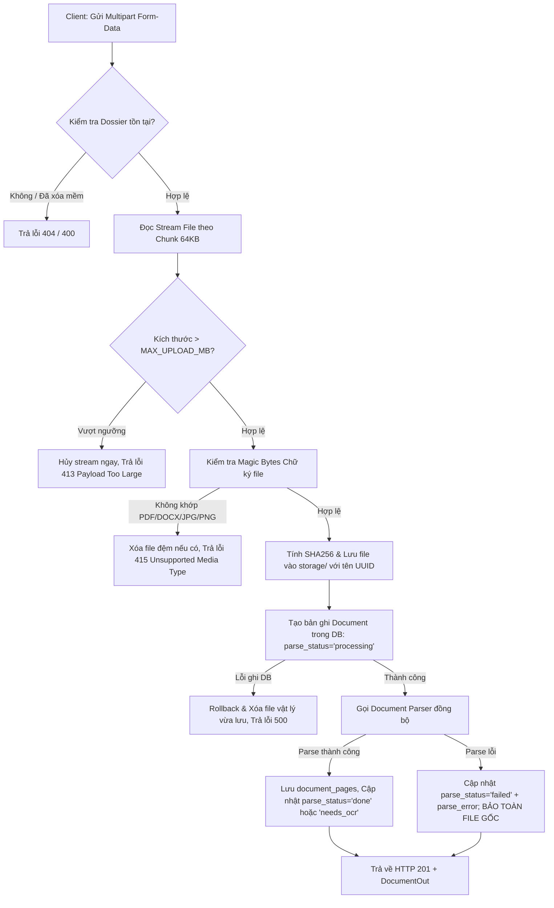

# KẾ HOẠCH TRIỂN KHAI CHI TIẾT - GIAI ĐOẠN 2
## UPLOAD TÀI LIỆU & DOCUMENT PARSER (PDF CÓ TEXT, DOCX)

> **Dự án:** Quản lý & Kiểm tra Hồ sơ điện tử NCKH  
> **Phiên bản:** Giai đoạn 2 (Upload, Local Storage, Text Parser, Preview & Page Viewer)  
> **Thời điểm lập:** 14/10/2026  

---

## 1. TỔNG QUAN & PHẠM VI TRIỂN KHAI

### 1.1. Phạm vi thực hiện trong Giai đoạn 2
1. **Upload tệp tin:** Hỗ trợ tải lên file vật lý (PDF có text, Word .docx, ảnh JPG/PNG) qua `multipart/form-data` gắn vào một bộ hồ sơ (`dossier`).
2. **Lưu trữ an toàn:** Lưu file vật lý vào thư mục `storage/` cục bộ với tên tệp chuẩn hóa UUID hex, tính toán mã băm SHA256, kích thước file và lưu đường dẫn tương đối vào cơ sở dữ liệu.
3. **Phân tích văn bản (Document Parser):**
   - Tự động trích xuất văn bản từ PDF (PyMuPDF) theo từng trang, ghi nhận số trang và đánh dấu `needs_ocr` nếu trang thiếu text.
   - Tự động trích xuất văn bản từ DOCX (python-docx) bao gồm cả đoạn văn (paragraphs) và bảng biểu (tables) theo thứ tự xuất hiện.
   - Đánh dấu ảnh JPG/PNG ở trạng thái `needs_ocr` (để chờ Giai đoạn 3).
4. **Cơ sở dữ liệu:** Thêm bảng `document_pages` lưu trữ nội dung từng trang; bổ sung các cột trạng thái parse (`parse_status`, `parse_error`, `file_size`, `sha256`) vào bảng `documents` qua Alembic migration mới.
5. **Giao diện người dùng:** Vùng kéo thả upload file, badge hiển thị trạng thái trích xuất, màn hình xem trước file (Preview) chia 2 cột (bên trái xem file gốc, bên phải xem nội dung text từng trang).
6. **Kiểm thử tự động:** Bộ test pytest độc lập sử dụng thư mục tạm (`tmp_path`), không làm ảnh hưởng đến thư mục `storage/` thực tế.

### 1.2. Giới hạn phạm vi (TUYỆT ĐỐI CHƯA LÀM Ở GĐ2)
- Chưa tích hợp OCR/Tesseract (sẽ làm ở Giai đoạn 3).
- Chưa tích hợp LLM trích xuất trường thông tin JSON (sẽ làm ở Giai đoạn 4).
- Cột `edited_text` trong `document_pages` chỉ tạo sẵn ở mức database schema và để nullable, chưa dùng trên giao diện.
- Chưa làm đăng nhập, phân quyền, Docker, microservices.
- Không dùng thư viện JavaScript ngoài Tailwind CSS CDN.

---

## 2. PHÂN TÍCH ĐIỂM MÂU THUẪN & ĐIỀU CHỈNH SO VỚI GIAI ĐOẠN 1

Dưới đây là các điểm khác biệt và điều chỉnh kỹ thuật cần xử lý để chuyển tiếp mượt mà từ Giai đoạn 1 sang Giai đoạn 2 mà không làm vỡ các chức năng cũ:

| Điểm khác biệt | Hiện trạng Giai đoạn 1 | Yêu cầu Giai đoạn 2 | Giải pháp kỹ thuật xử lý mâu thuẫn |
| :--- | :--- | :--- | :--- |
| **1. Endpoint tạo Document** | `POST /api/v1/documents` nhận JSON body `DocumentCreate` (chỉ tạo metadata, không có file). | `POST /api/v1/dossiers/{id}/documents` nhận `multipart/form-data` gồm file thực tế + `document_type`. | **Giữ lại cả hai:**<br>- Bổ sung endpoint mới `POST /api/v1/dossiers/{id}/documents` phục vụ luồng upload file.<br>- Giữ nguyên `POST /api/v1/documents` để 14 test cũ của Giai đoạn 1 tiếp tục pass 100% (gán `parse_status='no_file'`).<br>- Giao diện web chuyển hoàn toàn sang dùng luồng upload mới. |
| **2. Cấu trúc `DocumentOut`** | Chỉ có thông tin metadata cơ bản, chưa có `parse_status`, `file_size`, `page_count`. | Cần hiển thị trạng thái parse (`done`, `needs_ocr`, `failed`, `no_file`), dung lượng file và số trang. | Thêm các trường vào `DocumentOut` với giá trị mặc định hợp lý (`parse_status="no_file"`, `page_count=0`, `file_size=None`). |
| **3. Truy vấn danh sách Document** | `DossierDetailOut` và `list_documents` nạp trực tiếp danh sách Document. | Phải có số lượng trang (`page_count`) nhưng **TUYỆT ĐỐI KHÔNG** được nạp `raw_text` của các trang vào danh sách. | Dùng truy vấn `COUNT(document_pages.id)` qua subquery hoặc group by độc lập. Relationship `pages` trong model `Document` để lazy mặc định (không dùng `selectin`), đảm bảo `raw_text` chỉ được tải khi gọi `GET /documents/{id}/pages`. |
| **4. Các cột `storage_path` & `mime_type`** | Để nullable, comment ghi chú "chưa dùng ở GĐ1". | Lưu đường dẫn tương đối thực tế và MIME type chuẩn hóa từ chữ ký file. | Cập nhật comment trong model, lưu giá trị thực tế sau khi file được ghi vào đĩa thành công. |
| **5. Cấu hình & Biến môi trường** | Chỉ có `DATABASE_URL` và `CORS_ORIGINS`. | Cần cấu hình đường dẫn thư mục lưu trữ, giới hạn dung lượng upload, ngưỡng ký tự tối thiểu của trang PDF. | Bổ sung vào `.env.example` và `.env`:<br>- `STORAGE_DIR=storage`<br>- `MAX_UPLOAD_MB=20`<br>- `PARSER_MIN_CHARS_PER_PAGE=20` |
| **6. Thư viện phụ thuộc** | Chưa có thư viện xử lý upload multipart và đọc tài liệu. | Cần `python-multipart`, `PyMuPDF`, `python-docx`. | Bổ sung vào `requirements.txt` và cài đặt vào `.venv`. |

---

## 3. THIẾT KẾ CƠ SỞ DỮ LIỆU & ALEMBIC MIGRATION (REVISION 002)

> [!IMPORTANT]
> **Nguyên tắc Migration:** Tạo file migration MỚI (Revision 002), **TUYỆT ĐỐI KHÔNG** sửa file migration cũ `db115732abac_initial_schema.py`.  
> Sử dụng `batch_alter_table` (`render_as_batch=True`) để tương thích hoàn toàn với SQLite khi bổ sung cột. Migration phải chạy sạch trên cả database trắng và database GĐ1 đã có dữ liệu.

### 3.1. Bảng mới: `document_pages` (Trang tài liệu)

| Tên cột | Kiểu dữ liệu ORM | Kiểu CSDL | Nullable | Mặc định | Ý nghĩa & Ghi chú |
| :--- | :--- | :--- | :---: | :---: | :--- |
| `id` | `Mapped[int]` | `INTEGER` | Không | PK auto | Khóa chính |
| `document_id` | `Mapped[int]` | `INTEGER` | Không | - | FK trỏ tới `documents.id`, `ondelete="CASCADE"`, index=True |
| `page_number` | `Mapped[int]` | `INTEGER` | Không | - | Số thứ tự trang trong tài liệu (bắt đầu từ 1) |
| `raw_text` | `Mapped[str]` | `TEXT` | Không | "" | Nội dung text thô trích xuất từ trang (cho phép chuỗi rỗng) |
| `edited_text` | `Mapped[Optional[str]]` | `TEXT` | Có | `NULL` | Nội dung text sau hiệu chỉnh thủ công (chưa dùng ở GĐ2) |
| `parser_type` | `Mapped[str]` | `VARCHAR(50)` | Không | - | Loại bộ đọc: `'pymupdf'` \| `'python-docx'` (không dùng native enum) |
| `engine_version` | `Mapped[Optional[str]]` | `VARCHAR(50)` | Có | `NULL` | Phiên bản thư viện parser (VD: "fitz 1.25.3", "python-docx 1.1.2") |
| `created_at` | `Mapped[datetime]` | `DATETIME` | Không | `utcnow` | Thời điểm trích xuất trang (UTC) |

- **Ràng buộc duy nhất (Unique Constraint):**
  `UniqueConstraint("document_id", "page_number", name="uq_document_pages_doc_page")`

---

### 3.2. Cập nhật bảng `documents`

Bổ sung 4 cột mới vào bảng `documents` thông qua `batch_alter_table`:

| Tên cột bổ sung | Kiểu dữ liệu ORM | Kiểu CSDL | Nullable | Mặc định | Ý nghĩa & Ghi chú |
| :--- | :--- | :--- | :---: | :---: | :--- |
| `parse_status` | `Mapped[str]` | `VARCHAR(50)` | Không | `'no_file'` | Trạng thái trích xuất: `pending`, `processing`, `done`, `needs_ocr`, `failed`, `no_file`. Dữ liệu cũ giữ `'no_file'`. |
| `parse_error` | `Mapped[Optional[str]]` | `TEXT` | Có | `NULL` | Chi tiết thông báo lỗi nếu quá trình parse thất bại |
| `file_size` | `Mapped[Optional[int]]` | `INTEGER` | Có | `NULL` | Kích thước file thực tế tính bằng byte |
| `sha256` | `Mapped[Optional[str]]` | `VARCHAR(64)` | Có | `NULL` | Mã băm SHA-256 (64 ký tự hex) xác minh tính toàn vẹn |

---

### 3.3. Quan hệ ORM trong Model
```python
# Trong class Document (models.py):
pages: Mapped[List["DocumentPage"]] = relationship(
    "DocumentPage",
    back_populates="document",
    cascade="all, delete-orphan",
    order_by="DocumentPage.page_number",
    lazy="select",  # Lazy mặc định, tuyệt đối không dùng selectin để tránh load text nặng
)
```

---

## 4. QUY TRÌNH UPLOAD & LƯU TRỮ TỆP TIN AN TOÀN



### 4.1. Chi tiết kiểm tra Chữ ký File (Magic Bytes - Không dùng python-magic)
Tự xây dựng hàm kiểm tra nhị phân độc lập trên Windows:
- **PDF:** Header bắt đầu chính xác bằng 4 byte `b"%PDF"` (`%PDF-1.x`).
- **DOCX:** Bắt đầu bằng chữ ký file ZIP `b"PK\x03\x04"`. Mở qua `zipfile.ZipFile` và xác nhận có chứa tệp con `word/document.xml`.
- **JPEG/JPG:** Bắt đầu bằng 3 byte `b"\xFF\xD8\xFF"`.
- **PNG:** Bắt đầu bằng 8 byte `b"\x89PNG\r\n\x1a\n"`.
- **Tệp .doc cũ (Binary OLE `\xD0\xCF\x11\xE0`):** Bị từ chối thẳng với lỗi 415 nêu rõ hệ thống chỉ hỗ trợ định dạng `.docx` chuẩn hiện đại.

MIME type và đuôi file được suy ra trực tiếp từ loại file đã xác định, không tin tưởng vào phần mở rộng do người dùng gửi lên.

### 4.2. Quản lý thư mục lưu trữ
- Đường dẫn tuyệt đối thư mục lưu trữ: `STORAGE_PATH = ROOT_DIR / os.getenv("STORAGE_DIR", "storage")`.
- Tên tệp trên đĩa: `f"{uuid.uuid4().hex}.{ext}"` (ví dụ: `8a7b3c2d4e5f....pdf`).
- Giá trị lưu trong cột `documents.storage_path`: Lưu đường dẫn **tương đối** so với thư mục storage (ví dụ: `8a7b3c2d4e5f....pdf`).
- Đảm bảo an toàn dọn dẹp: Nếu lưu DB thất bại, file trên đĩa sẽ được tự động xóa (`unlink`). Nếu parse văn bản thất bại, file gốc **không** bị xóa để phục vụ parse lại sau này.
- Khi xóa mềm tài liệu hoặc hồ sơ: **Không xóa file vật lý** để đảm bảo có thể khôi phục lại nguyên trạng.

---

## 5. BỘ PHÂN TÍCH VĂN BẢN (DOCUMENT PARSER SERVICE)

File mô-đun: `backend/app/services/document_parser.py`

### 5.1. Cấu trúc kết quả trả về (`ParseResult`)
```python
class ParsedPage:
    page_number: int
    raw_text: str
    parser_type: str
    engine_version: Optional[str]

class ParseResult:
    status: str           # "done" | "needs_ocr" | "failed"
    error_message: Optional[str]
    pages: List[ParsedPage]
```

### 5.2. Logic phân tích từng định dạng

#### A. Tệp PDF (Xử lý qua PyMuPDF / fitz)
- Mở tài liệu bằng `fitz.open(file_path)`.
- Duyệt qua từng trang từ `0` đến `doc.page_count - 1`:
  - Trích xuất text: `text = page.get_text("text")`.
  - Luôn tạo **MỘT** bản ghi `document_pages` cho mỗi trang với `page_number = index + 1`, kể cả trang trắng, để giữ đúng đánh số trang pháp lý.
  - Kiểm tra độ dài: `len(text.strip()) < PARSER_MIN_CHARS_PER_PAGE` (mặc định 20 ký tự). Nếu có ít nhất 1 trang không đạt ngưỡng này, cờ `has_low_text_page = True`.
- Xác định trạng thái tài liệu:
  - Nếu `has_low_text_page == True`: `status = "needs_ocr"` (tài liệu chứa trang scan/ảnh, cần OCR ở GĐ3).
  - Nếu toàn bộ các trang đều có đầy đủ text: `status = "done"`.
- Bắt lỗi: Nếu file PDF bị đặt mật khẩu hoặc lỗi cấu trúc nhị phân, bắt ngoại lệ an toàn, trả về `status = "failed"` kèm nội dung lỗi cụ thể trong `error_message`, không làm sập ứng dụng.

#### B. Tệp DOCX (Xử lý qua python-docx)
- Mở tài liệu bằng `docx.Document(file_path)`.
- Đọc tuần tự toàn bộ nội dung bao gồm cả đoạn văn (Paragraphs) và bảng biểu (Tables) theo đúng thứ tự xuất hiện trong cây XML gốc (`doc.element.body`).
- Toàn bộ nội dung văn bản của file DOCX được lưu thành 1 trang duy nhất (`page_number = 1`, `parser_type = "python-docx"`).
- Nếu tổng số ký tự trích xuất được `< PARSER_MIN_CHARS_PER_PAGE`: Đánh dấu `status = "needs_ocr"`. Nếu có nội dung text hợp lệ: `status = "done"`.

#### C. Tệp Ảnh (JPG / PNG)
- Không chạy trích xuất text ở giai đoạn này.
- Không tạo bản ghi `document_pages`.
- Trả về danh sách trang rỗng `pages = []` và đặt `status = "needs_ocr"`.

---

## 6. DANH SÁCH API BỔ SUNG & CẬP NHẬT

| Method | Endpoint | Content-Type | Tham số & Request Body | Phản hồi thành công | Các mã lỗi |
| :--- | :--- | :--- | :--- | :--- | :--- |
| **POST** | `/api/v1/dossiers/{id}/documents` | `multipart/form-data` | `file`: UploadFile (bắt buộc)<br>`document_type`: DocumentType (mặc định OTHER) | **201 Created**<br>`DocumentOut` (kèm `page_count`, `parse_status`, `file_size`) | 400 (Dossier bị xóa mềm)<br>404 (Không thấy dossier)<br>413 (File > 20MB)<br>415 (Sai loại/chữ ký file)<br>422 (Thiếu file) |
| **GET** | `/api/v1/documents/{id}/file` | - | `download: bool = False`<br>`include_deleted: bool = False` | **200 OK**<br>File nhị phân (`FileResponse`), headers RFC 5987, `nosniff`, `inline` hoặc `attachment` | 404 (Không thấy file hoặc doc đã xóa mềm) |
| **GET** | `/api/v1/documents/{id}/pages` | `application/json` | `include_deleted: bool = False` | **200 OK**<br>`List[DocumentPageOut]` (sắp xếp tăng dần theo `page_number`) | 404 (Không thấy tài liệu) |
| **POST** | `/api/v1/documents/{id}/parse` | `application/json` | Không | **200 OK**<br>`DocumentOut` (kèm trạng thái sau khi parse lại) | 400 (Tài liệu chưa có file vật lý)<br>404 (Không thấy tài liệu) |
| **POST** | `/api/v1/documents` *(Cũ)* | `application/json` | `DocumentCreate` (chỉ metadata) | **201 Created**<br>`DocumentOut` (`parse_status="no_file"`) | Giữ nguyên để tương thích ngược 100% test GĐ1 |

---

## 7. THIẾT KẾ GIAO DIỆN NGƯỜI DÙNG (CHI TIẾT BỘ HỒ SƠ)

Giao diện tiếp tục tuân thủ phong cách **Modern Tech Minimalist** (Antigravity):

### 7.1. Vùng kéo thả Upload tài liệu (Drag & Drop Zone)
- Đặt ngay trong màn hình Chi tiết Bộ hồ sơ.
- Thiết kế: Khung nét đứt bo tròn lớn (`border-2 border-dashed border-slate-300 rounded-2xl bg-slate-50/50 hover:bg-indigo-50/30 transition-all`).
- Hiệu ứng trực quan khi kéo file vào (Dragover: đổi màu viền sang indigo-500, phóng to nhẹ).
- Bộ chọn loại tài liệu (`document_type`) đặt cạnh ô chọn file.
- Client validation: Báo lỗi ngay lập tức nếu người dùng chọn file sai đuôi hoặc vượt quá 20MB mà chưa cần gửi lên server.
- Thanh tiến trình tải lên (Upload Progress bar) bằng `XMLHttpRequest` hiển thị % tải lên mượt mà.

### 7.2. Cập nhật Bảng danh sách Tài liệu
- Hiển thị thêm các cột:
  - **Dung lượng file:** Định dạng chuẩn thân thiện (VD: `1.2 MB`, `450 KB`, `-` nếu chưa có file).
  - **Số trang:** Hiển thị số lượng trang đã trích xuất (VD: `4 trang`).
  - **Trạng thái trích xuất (Parse Status Badge):**
    - `done`: Badge màu xanh lá (`bg-emerald-100 text-emerald-800`) - *"Đã trích xuất"*
    - `needs_ocr`: Badge màu vàng hổ phách (`bg-amber-100 text-amber-800`) - *"Chờ OCR"*
    - `failed`: Badge màu đỏ (`bg-rose-100 text-rose-800`) - *"Lỗi đọc file"*
    - `no_file`: Badge màu xám (`bg-slate-100 text-slate-700`) - *"Chưa có file"*
  - **Nút hành động:** Bổ sung nút **"Xem nội dung"** mở modal viewer 2 cột.

### 7.3. Màn hình Xem trước Tài liệu (Document Viewer Modal - 2 Cột)
Mở modal toàn màn hình (`max-w-6xl`):
- **Cột Trái (50%): Preview File Gốc**
  - Tệp PDF: Nhúng thẻ `<iframe src="/api/v1/documents/{id}/file" class="w-full h-full rounded-xl border"></iframe>` cho phép cuộn, phóng to, in ấn trực tiếp từ trình duyệt.
  - Tệp Ảnh (JPG/PNG): Hiển thị ảnh gốc qua thẻ ``.
  - Tệp Word (DOCX): Hiển thị thông báo thân thiện *"Trình duyệt không hỗ trợ xem trước trực tiếp file Word"* kèm nút nổi bật **"Tải file DOCX về máy"** (`download=true`).
- **Cột Phải (50%): Raw Text Theo Từng Trang**
  - Thanh công cụ trên cùng: Bộ chọn số trang (Trang 1, 2, 3...) hoặc cuộn liên tục; hiển thị loại bộ đọc (`pymupdf` / `python-docx`) và phiên bản thư viện; nút **"Parse lại"** kèm spinner.
  - Khung nội dung text: Khung cuộn `font-mono text-xs whitespace-pre-wrap bg-slate-50 p-4 rounded-xl border border-slate-200 text-slate-800`.
  - Trạng thái `needs_ocr`: Hiển thị banner thông báo *"Tài liệu chưa có lớp text tin cậy (dạng scan/ảnh). Nội dung sẽ được nhận diện tự động ở Giai đoạn 3 (OCR)."*

---

## 8. DANH MỤC KỊCH BẢN KIỂM THỬ TỰ ĐỘNG (PYTEST)

Kiểm thử được tổ chức trong `backend/tests/test_upload_and_parser.py`:
> [!IMPORTANT]
> Sử dụng fixture `tmp_path` của pytest để tạo thư mục lưu trữ tạm thời cho từng test case, ghi đè biến cấu hình storage path, **TUYỆT ĐỐI KHÔNG** ghi file test vào thư mục `storage/` thật của dự án. File test được sinh tự động bằng code qua PyMuPDF và python-docx.

1. **`test_upload_pdf_with_text_success`**: Tạo file PDF 3 trang có text thật -> upload -> kiểm tra mã 201, số trang = 3, đúng `page_number`, `parse_status = 'done'`, sha256 khớp.
2. **`test_upload_docx_with_paragraphs_and_tables`**: Tạo file DOCX có 2 đoạn văn và 1 bảng 3x3 -> upload -> kiểm tra 1 trang, nội dung text chứa đầy đủ text của cả đoạn văn lẫn bảng.
3. **`test_upload_pdf_scanned_or_empty_triggers_needs_ocr`**: Tạo PDF có trang trắng/trang chỉ chứa ảnh không text -> upload -> kiểm tra `parse_status = 'needs_ocr'`.
4. **`test_upload_image_jpg_png_triggers_needs_ocr`**: Upload file ảnh PNG/JPG hợp lệ -> kiểm tra lưu file thành công, không tạo trang nào, `parse_status = 'needs_ocr'`.
5. **`test_reject_file_exceeding_max_size`**: Thử upload file > 20MB -> kiểm tra trả về HTTP 413, không lưu file rác vào đĩa.
6. **`test_reject_invalid_file_signature_spoofing`**: Tạo file text giả mạo đuôi `.pdf` (nội dung `Hello world`, không có magic bytes `%PDF`) -> kiểm tra trả về HTTP 415.
7. **`test_reject_legacy_doc_format`**: Upload file nhị phân OLE `.doc` cũ -> kiểm tra trả về HTTP 415 từ chối rõ ràng.
8. **`test_corrupted_pdf_handling`**: Tạo file có header `%PDF` nhưng thân file hỏng -> upload -> kiểm tra vẫn lưu file vật lý an toàn, `parse_status = 'failed'` + có `parse_error`.
9. **`test_upload_to_nonexistent_or_deleted_dossier`**: Thử upload vào dossier không tồn tại (404) hoặc dossier đã bị xóa mềm (400).
10. **`test_get_file_inline_and_download`**: Kiểm tra endpoint `/documents/{id}/file` trả về đúng Content-Type, header RFC 5987 và tham số `download=true`.
11. **`test_get_pages_ordered`**: Kiểm tra `/documents/{id}/pages` trả về danh sách trang được sắp xếp đúng thứ tự `page_number`.
12. **`test_reparse_document_idempotency`**: Gọi POST `/documents/{id}/parse` nhiều lần -> kiểm tra thay thế trang cũ trong 1 transaction, không bị nhân đôi số trang.
13. **`test_document_list_and_detail_does_not_leak_raw_text`**: Kiểm tra response của danh sách tài liệu và chi tiết hồ sơ có `page_count` chính xác nhưng hoàn toàn không chứa trường `raw_text`.
14. **`test_soft_delete_preserves_physical_file`**: Xóa mềm tài liệu -> kiểm tra file trên đĩa vẫn tồn tại; khôi phục tài liệu -> file vẫn hoạt động bình thường.
15. **`test_regression_phase_1_tests_pass`**: Chạy lại toàn bộ 14 bài test của Giai đoạn 1 đảm bảo 100% không bị ảnh hưởng.

---

## 9. KẾ HOẠCH NGHIỆM THU 7 TIÊU CHÍ (GIAI ĐOẠN 2)

| STT | Tiêu chí nghiệm thu | Cách thức kiểm tra & Bằng chứng thực tế |
| :---: | :--- | :--- |
| **1** | `alembic upgrade head` chạy sạch trên DB mới và DB GĐ1 | Chạy migration trên `app.db` hiện tại (có sẵn dữ liệu GĐ1) không mất dữ liệu; và chạy trên file db mới trắng tinh. |
| **2** | Upload PDF có text và DOCX thành công; file gốc được lưu với tên UUID và SHA256 khớp | Tải lên file thực tế qua API/Web, kiểm tra file xuất hiện trong `storage/` với tên UUID hex, tính lại SHA256 so khớp với CSDL. |
| **3** | Giao diện hiển thị preview file gốc và raw text theo từng trang | Mở modal chi tiết tài liệu: xem được PDF trực tiếp trên iframe và xem text theo từng trang ở cột bên phải. |
| **4** | PDF scan / ảnh được đánh dấu `needs_ocr`, không báo "done" sai | Upload ảnh PNG hoặc file PDF scan không có lớp text, kiểm tra badge trạng thái hiển thị đúng "Chờ OCR". |
| **5** | Các trường hợp lỗi (sai loại, quá lớn, file hỏng) trả lỗi rõ ràng và không làm mất dữ liệu cũ | Gửi file giả mạo đuôi, file quá 20MB, file hỏng -> kiểm tra nhận mã lỗi 413, 415, 422 với message tiếng Việt rõ ràng. |
| **6** | Toàn bộ pytest (cũ + mới) pass | Chạy `pytest backend/tests -v` đạt 100% pass (cả 14 test cũ và ~15 test mới). |
| **7** | Test được các API mới tại `/docs` | Mở `http://localhost:8000/docs`, kiểm thử các endpoint upload multipart, get file, get pages và reparse. |

---
*Kế hoạch đã được hoàn thiện chi tiết và sẵn sàng chờ bạn duyệt để bắt đầu triển khai code!*
